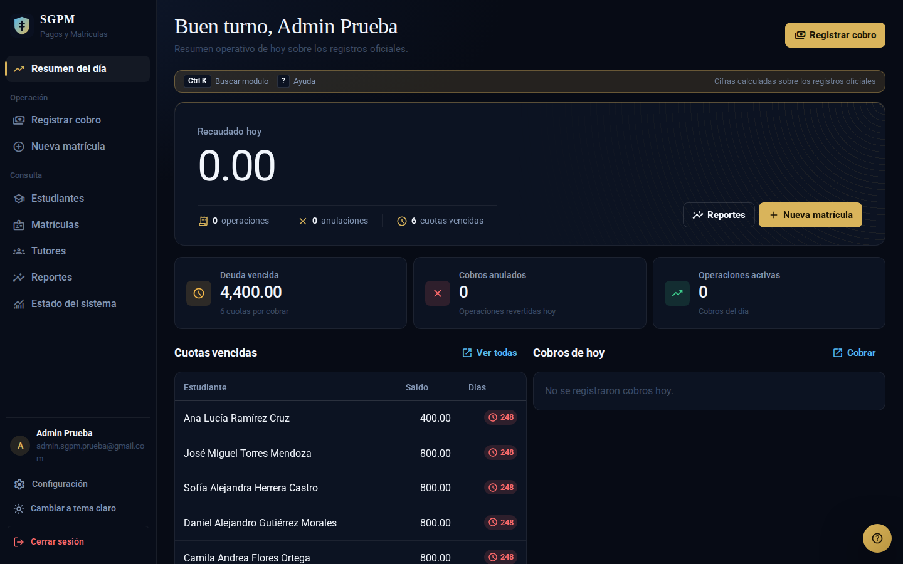
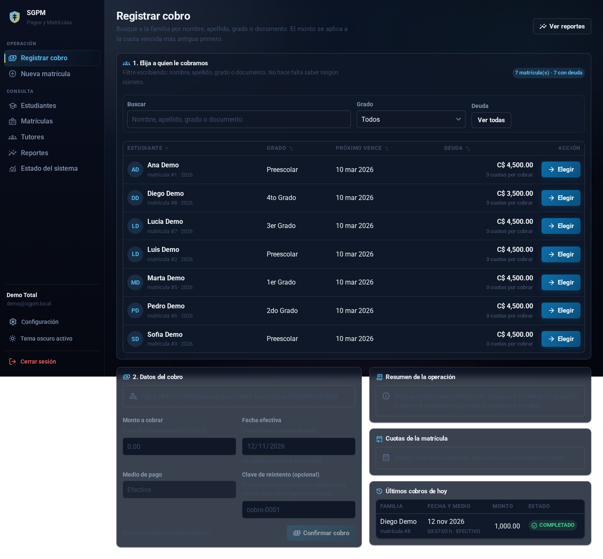
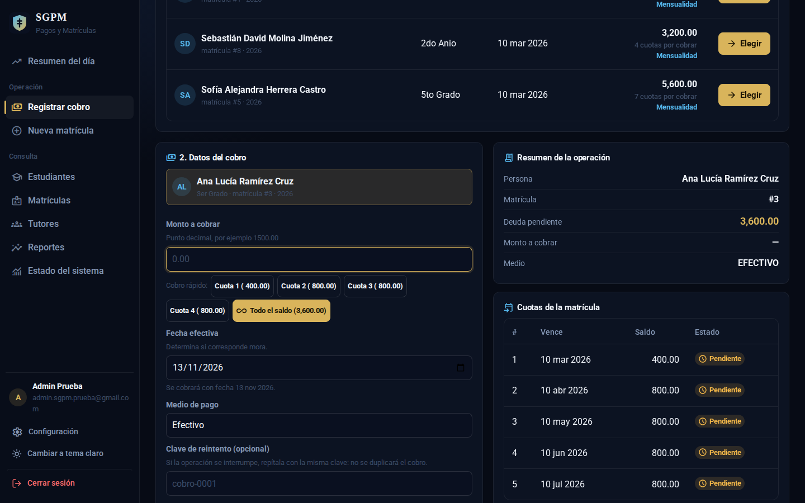
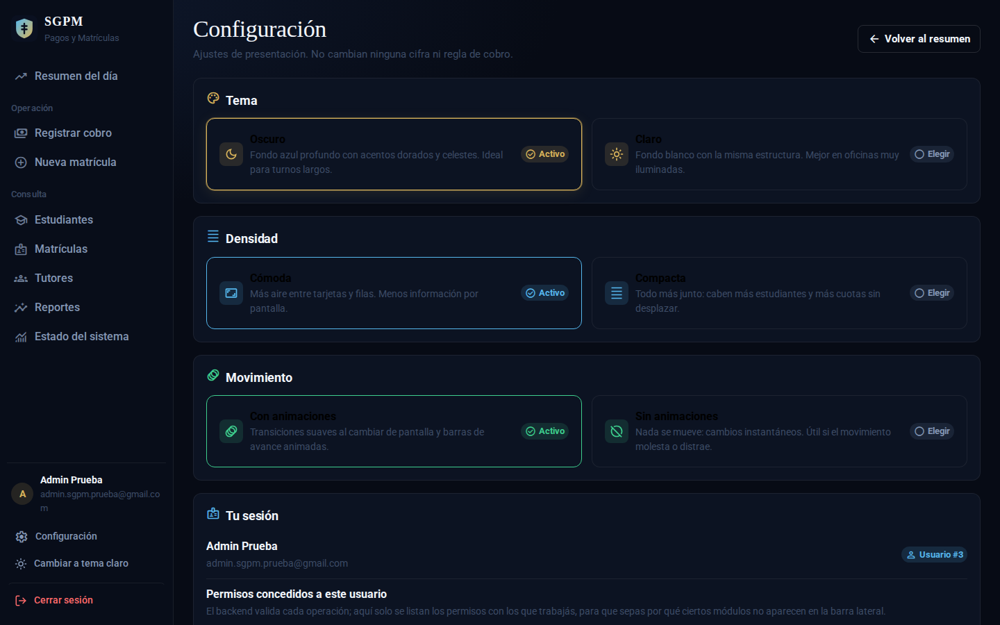
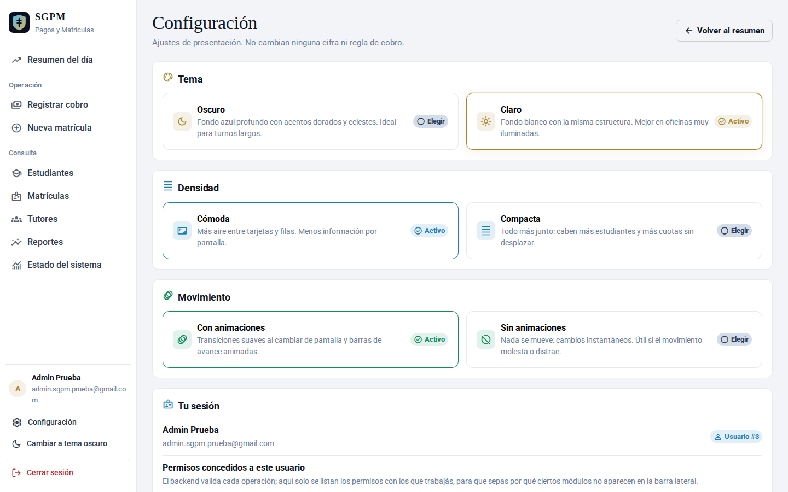
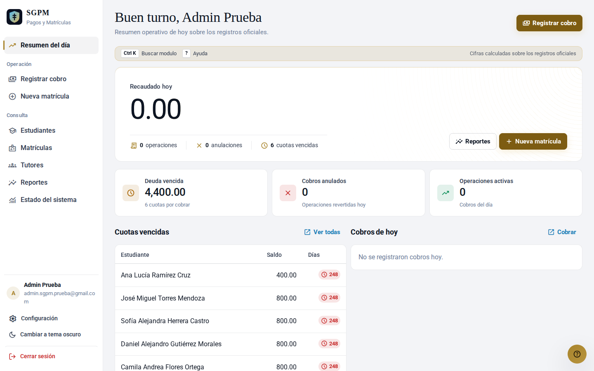
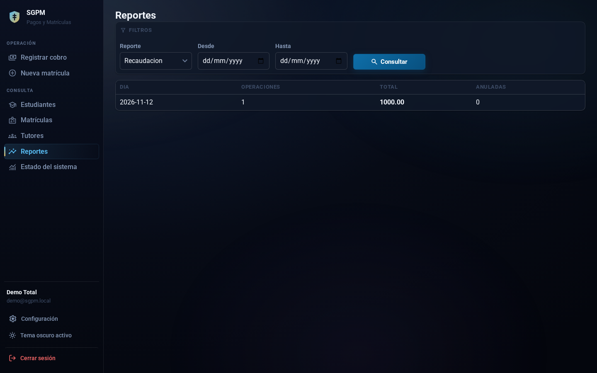
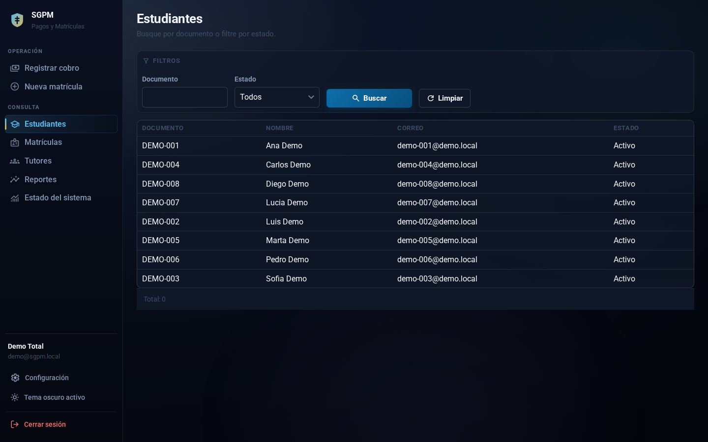
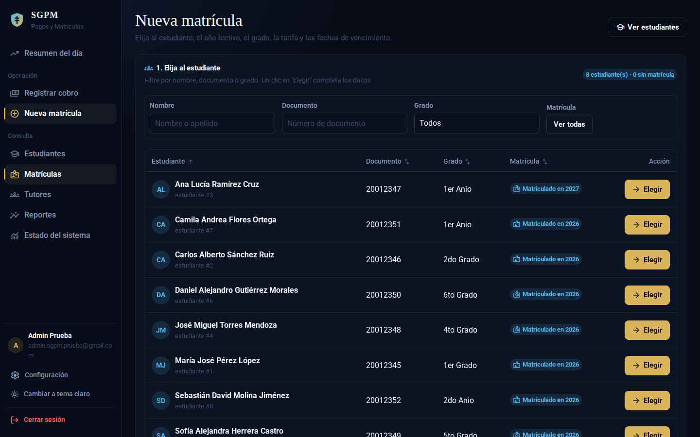

# SGPM - Sistema de Gestion de Pagos y Matriculas

Colegio Cristiano Maranatha

Sistema de gestion de pagos y matriculas para colegios: motor financiero
(planes de pago, abonos FIFO, mora, descuentos), comprobantes y panel web.
Interfaz en espanol, tema oscuro premium por defecto (conmutable a claro).

## Capturas de la interfaz

Tomadas sobre la aplicacion real, con los datos de demostracion cargados.

### Portada: resumen del dia



Lo primero que se ve al entrar: lo recaudado hoy, la deuda vencida, las cuotas
por cobrar y los ultimos cobros. Todas las cifras salen de los registros
almacenados (Fase 8), no de calculos de la interfaz.

### Registrar cobro: se elige a la familia por su nombre



La queja que origino este rediseno era concreta: *"tengo que adivinarme el
numero de matricula"*. Ahora la persona se busca como se habla en un colegio
(nombre, apellido, grado o documento), en una tabla que se filtra mientras se
escribe y con orden por columna.

### Registrar cobro: familia elegida



Al elegir una fila se habilitan los campos, se muestra su deuda almacenada y
sus cuotas, y el panel derecho resume la operacion ANTES de confirmar
(prevencion de errores). Los importes se muestran con moneda y separador de
miles (`C$ 4,500.00`), tomados como texto exacto de PostgreSQL.

### Configuracion de apariencia



Tema (oscuro/claro), densidad y movimiento, cada uno con su explicacion. Se
guarda en el navegador y no cambia ninguna cifra ni regla de cobro.

### Tema claro





### Reportes y estudiantes





### Nueva matrícula: también se elige, no se escriben identificadores



El mismo criterio del cobro: el estudiante se busca por nombre y los año, grado
y tarifa se eligen de listas reales (nadie se sabe los identificadores internos).

## Requisitos

- Node.js 22+
- npm 10+
- PostgreSQL 16+

## Instalacion

### 1. Clonar el repositorio

```bash
git clone <repo-url>
cd sgpm
```

### 2. Backend

```bash
cd backend
cp .env.example .env
# Editar .env con tus credenciales de PostgreSQL
npm install
npm run dev
```

El servidor Express arranca en http://localhost:3000

### 3. Frontend

```bash
cd frontend
npm install
npm run dev
```

La aplicacion React arranca en http://localhost:5173

### 4. Base de datos

Crear la base de datos y usuario:

```sql
CREATE ROLE sgpm_user WITH LOGIN PASSWORD 'sgpm_dev_password';
CREATE DATABASE sgpm_dev OWNER sgpm_user;
```

### 5. Verificacion

```bash
# Backend
cd backend && npm test

# Frontend
cd frontend && npm test
```

## Endpoints de diagnostico

- `GET /api/health` - Estado del servidor y conexion a BD
- `GET /api/ready` - Readiness probe

## Estructura del proyecto

```
sgpm/
├── frontend/          # React 19 + Vite + TypeScript
├── backend/           # Node.js 22 + Express 5 + TypeScript
├── database/          # Migraciones, seeds, scripts
├── docs/              # Documentacion del proyecto
├── deployment/        # Configuracion de despliegue
├── scripts/           # Scripts de utilidad
└── README.md
```

## Stack tecnologico

- **Frontend:** React 19, Vite, TypeScript, React Router 7, Axios
- **Backend:** Node.js 22, Express 5, TypeScript, Zod, Helmet, CORS
- **Base de datos:** PostgreSQL 16, driver pg
- **Testing:** Vitest, Supertest, Testing Library
- **Linting:** ESLint, TypeScript ESLint
